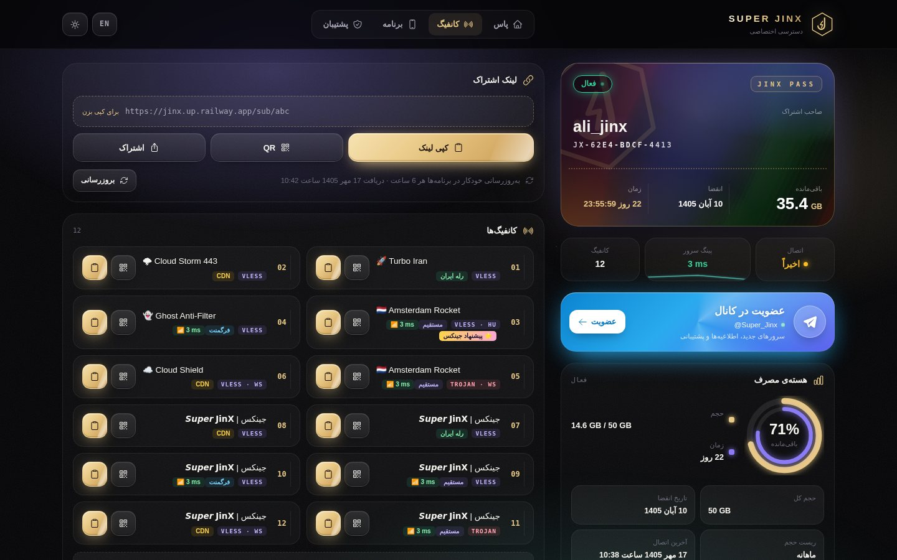
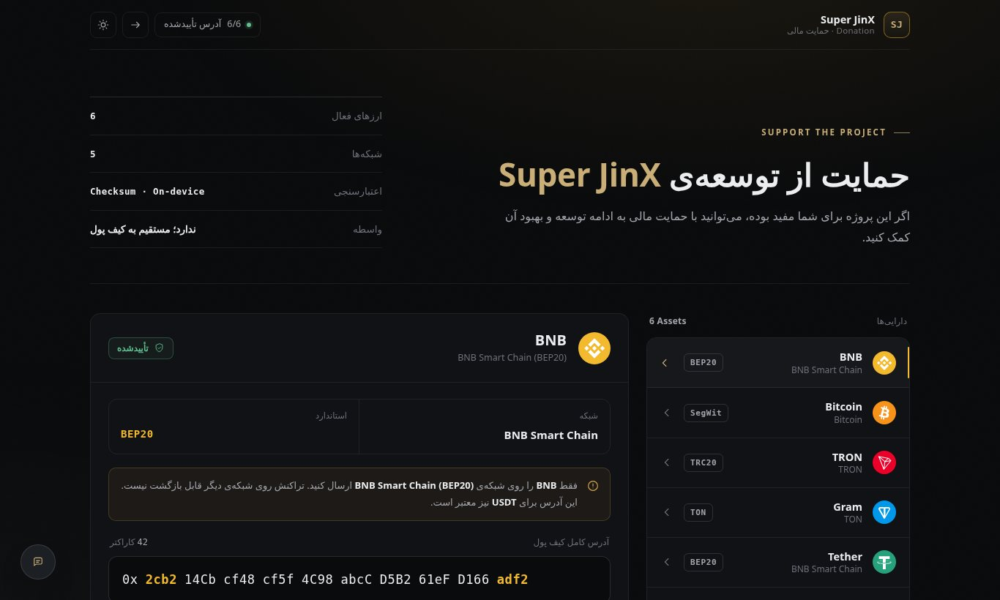
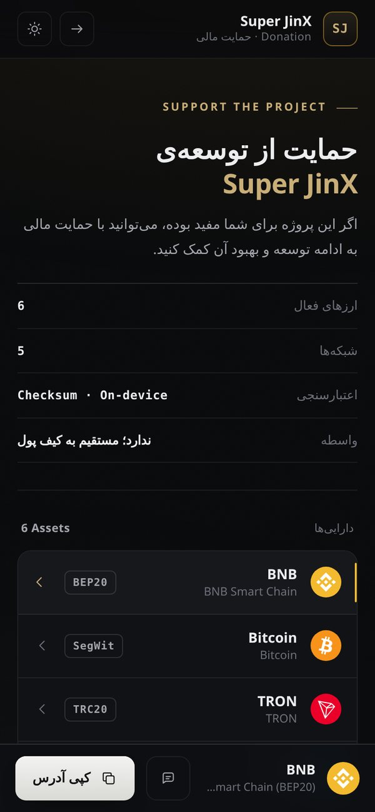
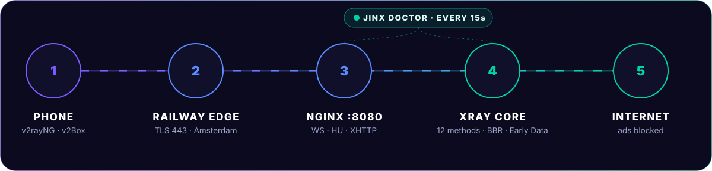

<div align="center">



[فارسی](README.md) | **English** | [Русский](README.ru_RU.md) | [中文](README.zh_CN.md)

<br/>


<br/><br/>

**A free, one-click Marzban VPN panel for Railway.**<br/>
No VPS, no domain, no certificates. Deploy in five minutes and share your first subscription link.

<br/>

<a href="https://t.me/Super_Jinx"></a>
<a href="https://github.com/x4gpanell"></a>


<br/><br/>


</div>

## Overview

**Super JinX** packages the official [Marzban](https://github.com/Gozargah/Marzban) panel, nginx and [Xray-core](https://github.com/XTLS/Xray-core) into a single Railway service. Everything runs behind one port, TLS is handled by Railway on 443, and every setting that usually needs a terminal is already done for you.

On top of Marzban it adds 12 ready-made connection methods, reseller panels with server-side limits, a custom subscription page, a self-healing watchdog, a locked inbound that cannot be broken from the panel, and a fully translated interface.

## Table of Contents

- [Features](#features)
- [Screenshots](#screenshots)
- [Quick Start](#quick-start)
- [How It Works](#how-it-works)
- [Connection Methods](#connection-methods)
- [Reseller Panels](#reseller-panels)
- [Subscription Page](#subscription-page)
- [Self-Healing](#self-healing)
- [Security](#security)
- [Optional Routes](#optional-routes)
- [Environment Variables](#environment-variables)
- [Regions](#regions)
- [Recommended Clients](#recommended-clients)
- [Troubleshooting](#troubleshooting)
- [Donation](#donation)
- [Community](#community)

<p align="center"></p>

## Features



- **One-click deploy** on Railway with `admin / admin` on first login, changeable from the panel menu
- **12 direct connection methods** across VLESS, VMess, Trojan, WebSocket and HTTPUpgrade, each with its own TLS fingerprint and fragment profile
- **Optional Reality** through Railway TCP Proxy and **Mirror** configs on extra domains
- **Tuned for speed**: BBR, WebSocket heartbeat, early data (`ed=2560`), QUIC blocking and plain links that work in every app
- **Reseller panels** with a creation wizard, ready packages and limits enforced on the server
- **JinX Pass** subscription page with separate desktop and mobile layouts, live ping and QR codes
- **Self-healing watchdog** that checks every part of the service every 15 seconds and keeps daily backups
- **Locked inbound**, login lock after 10 wrong passwords and server-side ad blocking
- **Four languages** for everything Super JinX adds: Persian, English, Russian and Chinese

<p align="center"></p>

## Screenshots

<table>
<tr>
<td width="70%"></td>
<td width="30%"></td>
</tr>
<tr>
<td align="center"><sub>JinX Pass · desktop</sub></td>
<td align="center"><sub>JinX Pass · mobile</sub></td>
</tr>
<tr>
<td></td>
<td></td>
</tr>
<tr>
<td align="center"><sub>Donation page · desktop</sub></td>
<td align="center"><sub>Donation page · mobile</sub></td>
</tr>
</table>

<p align="center"></p>

## Quick Start


| Step | Action |
|:--:|---|
| 1 | **Star** and **Fork** this repository |
| 2 | In [Railway](https://railway.com) choose `New Project` → `Deploy from GitHub repo` and pick your fork |
| 3 | `Settings` → `Deploy` → `Regions` → **EU West (Amsterdam)**, the lowest latency from Iran |
| 4 | `Attach Volume` with the mount path **`/var/lib/marzban`** |
| 5 | `Settings` → `Networking` → `Generate Domain` on port **`8080`** |
| 6 | Make sure **Serverless / App Sleeping is off** |
| 7 | **Redeploy** |

<div align="center">

| Panel | Username | Password |
|:--:|:--:|:--:|
| `https://<your-domain>.up.railway.app/dashboard/` | `admin` | `admin` |

</div>

> [!IMPORTANT]
> After the first login open the menu and choose **Change username and password**. The change applies instantly and survives redeploys.

<p align="center"></p>

## How It Works



Railway terminates TLS on port 443 and forwards everything to nginx on port **8080**. nginx serves the panel, the subscription page and every Xray transport from that single port. The **JinX Doctor** watchdog checks each component every 15 seconds. No certificates are needed and nothing ever expires.

<p align="center"></p>

## Connection Methods


Every config name starts with **جینکس | 𝗝𝗶𝗻𝗫**, followed by the method name and the protocol.

| # | Method | Protocol | Fingerprint | Notes |
|:--:|---|---|:--:|---|
| 1 | **Amsterdam Rocket** | JinX Core | ios | Direct, full speed. The name follows the region |
| 2 | **Ghost Anti-Filter** | JinX Core | chrome | Strong fragment for filtered SNI |
| 3 | **Hyper Drive** | VLESS WS | firefox | — |
| 4 | **Swift Shield** | VLESS WS | chrome | Light fragment |
| 5 | **Vortex** | VMess WS | safari | Full speed |
| 6 | **Trident** | Trojan WS | edge | — |
| 7 | **Ninja Stealth** | Trojan WS | random | Strong fragment |
| 8 | **Lightning** | HTTPUpgrade | chrome | Lightest transport, full speed |
| 9 | **Meteor** | HTTPUpgrade | ios | Light fragment |
| 10 | **Warp Speed** | XHTTP packet-up | chrome | Short requests, passes any network |
| 11 | **Nebula** | HTTPUpgrade | firefox | — |
| 12 | **Quantum** | XHTTP stream-up | edge | One steady stream, high speed |
| + | **Reality Pulse**, **Dark Matter** | Reality | chrome, firefox | When TCP Proxy is enabled |
| + | **Mirror** | JinX Core, HTTPUpgrade | chrome | Extra domains of the same service |

The two XHTTP configs (same recipe as the Vodiwalker panel) use `alpn=h2,http/1.1`; `JINX_XHTTP=0` turns them off. If a transport is missing, the same names move to the next one (HTTPUpgrade, then WebSocket), so there are always 12 configs with no duplicate names.

### Speed Tuning

All of the following is enabled automatically.

| Feature | Effect |
|---|---|
| **16k connections** | nginx accepts 16,384 connections per worker, so busy panels stay fast |
| **No Mux** | Hiddify, Clash and sing-box connect without problems |
| **BBR** | Steadier throughput on mobile networks, when the host kernel allows it |
| **Heartbeat** | A tiny ping every 30 seconds keeps idle lines from being cut by operators |
| **Early data** | One round trip less for every new connection |
| **QUIC blocking** | Browsers and YouTube fall back to TCP, which is smoother inside the tunnel |
| **HTTP latency test** | sing-box and Clash clients test with one round trip less |
| **Plain links for every app** | each app builds its own config (like SuperJinX); full JSON can be turned on with a variable |

> [!TIP]
> Real ping, never a fake number. In v2rayNG or V2Box set the test URL to `http://cp.cloudflare.com/` and run a group test. The subscription page also highlights the recommended config.

### Reality

Reality traffic skips Railway's web edge and has the lowest overhead.

1. `Settings` → `Networking` → **TCP Proxy** with application port **`2010`**
2. **Redeploy**. Two configs, **Reality Pulse** and **Dark Matter**, are added to every subscription automatically.

<p align="center"></p>

## Reseller Panels

Open the menu and choose **Reseller panels**. Only the main admin sees this option.

| Option | Description |
|---|---|
| **Packages** | Bronze `10 · 100 GB · 30 d`, Silver `50 · 500 GB · 30 d`, Gold `100 · 1 TB · 30 d`, Diamond `500 · 5 TB · 90 d`, Custom |
| **Live checks** | Taken usernames and invalid limits are shown instantly |
| **Strong passwords** | 14-character generator with a strength meter |
| **Preview and hand-off** | Live card, per-field copy, copy all and share |
| **Top-up and renew** | Traffic, days and user slots in one step |
| **History** | Every reseller action with date and time |
| **Server-side limits** | User count, traffic and expiry cannot be bypassed |

Resellers sign in at **`https://<your-domain>/agent/`** and are greeted with a dedicated welcome message. Deleting a reseller keeps its users and moves them to the main admin.

<p align="center"></p>

## Subscription Page

- Glowing membership card with traffic, expiry and status
- Separate layouts for **desktop** and **mobile**
- Live ping next to every config and a recommended pick
- One-tap import for Android, iOS and Windows
- Reliable copy, built-in QR codes, copy all and config file download
- **JinX Care** assistant that checks the phone clock, the connection, the server and the ping
- Dark and light themes, Persian and English
- No external requests of any kind

<p align="center"></p>

## Self-Healing

| If this breaks | JinX Doctor does this |
|---|---|
| nginx | Starts it again |
| Xray core | Tests a real connection every 60 seconds and restarts the core if needed |
| Panel stops responding | Restarts the whole service cleanly |
| Broken Xray config | Backs it up and rebuilds it |
| Subscription links | Keeps every host correct every 20 seconds |
| Subscription or donation page | Restores it from a golden copy |
| Database | Daily backup, the newest 7 are kept |

> Set `DOCTOR_TG_TOKEN` and `DOCTOR_TG_CHAT` to receive alerts on Telegram: repairs, reseller traffic and expiry warnings, and repeated wrong passwords.

<p align="center"></p>

## Security

| | |
|---|---|
| **Credentials** | Change the username and password from the menu. It applies instantly and survives redeploys |
| **Login lock** | 10 wrong passwords close the login for 5 minutes, enforced on the server per IP and per username |
| **Locked inbound** | Core settings are read-only, the Xray config is rebuilt on every start and hosts are restored within 20 seconds |
| **Persistent data** | Database, users and resellers live on the Railway volume |

<p align="center"></p>

## Optional Routes

<details>
<summary><b>Iranian relay server</b></summary>

<br/>

```
Client  ──►  Iran VPS :443  ══ TLS passthrough ══►  Railway
```

On an Ubuntu or Debian server in Iran:

```bash
sudo bash iran-relay.sh xxxx.up.railway.app
```

Then set `IRAN_RELAY_IP=<server-ip>` in Railway and redeploy.

</details>

<details>
<summary><b>Cloudflare Tunnel</b></summary>

<br/>

1. Add a domain to Cloudflare.
2. `Zero Trust` → `Networks` → `Tunnels` → `Create a tunnel` (Cloudflared) and copy the token.
3. Add a public hostname with the service `HTTP` → `127.0.0.1:8080`.
4. Set these variables and redeploy:

```env
CF_TUNNEL_TOKEN=<token>
CF_TUNNEL_HOSTNAME=jinx.example.com
CF_CLEAN_IP=<optional clean IP>
```

</details>

<p align="center"></p>

## Environment Variables

All variables are optional.

<details>
<summary><b>Full list</b></summary>

<br/>

| Variable | Default | Description |
|---|---|---|
| `PANEL_DOMAIN` | | Custom domain |
| `RESET_ADMIN_PASSWORD` | | `1` resets the login to `admin / admin`. Remove it afterwards |
| `SUB_UPDATE_INTERVAL` | `6` | Subscription auto-update interval in hours |
| `DOCTOR_TG_TOKEN`, `DOCTOR_TG_CHAT` | | Telegram alerts |
| `TELEGRAM_API_TOKEN`, `TELEGRAM_ADMIN_ID` | | Marzban's own Telegram bot |
| `CF_TUNNEL_TOKEN`, `CF_TUNNEL_HOSTNAME` | | Cloudflare Tunnel |
| `CF_CLEAN_IP`, `CF_PORTS` | `443,2053,8443` | Clean IPs and ports |
| `IRAN_RELAY_IP`, `IRAN_RELAY_PORT` | `443` | Iranian relay |
| `JINX_EXTRA_DOMAINS` | | Extra domains, one Mirror config each |
| `JINX_REALITY_SNI` | `www.speedtest.net` | Reality cover site |
| `JINX_FRAGMENT` | `10-20,10-20,tlshello` | Strong fragment, empty disables it |
| `JINX_FRAGMENT_LIGHT` | `100-200,1-3,tlshello` | Light fragment |
| `JINX_MUX` | `0` | `1` = on (only for v2rayNG with JSON; Hiddify and Clash cannot connect with Mux) |
| `JINX_BBR`, `JINX_ADBLOCK`, `JINX_FAST`, `JINX_REALITY` | `1` | `0` turns the feature off |
| `JINX_HEARTBEAT` | `30` | Seconds, `0` turns it off |
| `USE_CUSTOM_JSON_FOR_V2RAYNG` | `False` | `True` = full JSON (with Mux and fragment) for v2rayNG, v2rayN, Streisand and Happ |

</details>

<p align="center"></p>

## Regions

| Railway region | Status |
|---|:--:|
| **EU West · Amsterdam** | Recommended |
| US East · Virginia | Supported |
| US West · California | Supported |
| Southeast Asia · Singapore | Supported |

For several locations, create one service per region from the same repository.

## Recommended Clients

| Android | iOS | Windows / macOS |
|:--:|:--:|:--:|
| v2rayNG · Hiddify · NekoBox | Streisand · V2Box · Hiddify | v2rayN · Hiddify · Clash Verge |

Keep Mux off in the app (the Xray server cannot use the Mux of apps like Hiddify). Tap **Update subscription** after every change.

<p align="center"></p>

## Troubleshooting

<details><summary><b>Configs disconnect after a while</b></summary><br/>Turn off Serverless / App Sleeping in the service settings.</details>

<details><summary><b>Deploy fails on the health check</b></summary><br/>The domain port must be <code>8080</code>. Check the <code>alembic</code> and <code>main.py</code> logs.</details>

<details><summary><b>Forgot the password</b></summary><br/>Add <code>RESET_ADMIN_PASSWORD=1</code>, redeploy, sign in with <code>admin / admin</code> and remove the variable.</details>

<details><summary><b>Users disappear after a redeploy</b></summary><br/>The volume is not mounted on <code>/var/lib/marzban</code>.</details>

<details><summary><b>Subscription shows <code>{SERVER_IP}</code></b></summary><br/>Wait 20 seconds and update the subscription. The guard fixes it automatically.</details>

<details><summary><b>Direct configs do not connect</b></summary><br/>Try Ghost Anti-Filter, Ninja Stealth or Swift Shield. If that fails, use Reality or the Cloudflare Tunnel.</details>

<details><summary><b>Saving core settings returns 403</b></summary><br/>This is intentional. The inbounds are locked so the panel can never be broken.</details>

<details><summary><b>High ping</b></summary><br/>Use the Amsterdam region, set the client test URL to <code>http://cp.cloudflare.com/</code> and pick Lightning or Reality.</details>

<p align="center"></p>

## Donation

The **Donate** button in the bottom corner of the panel opens `https://<your-domain>/donate/`. Every address is verified with its network checksum before it is shown, the QR codes are generated on the device and the page makes no external requests. To use your own addresses, edit only `donate-config.js`.

## Community

News, guides and support are published on the Telegram channel.

<div align="center">

<a href="https://t.me/Super_Jinx"></a>
<a href="https://github.com/x4gpanell"></a>

<br/><br/>

If Super JinX helps you, please give it a star.

<sub>Built on <a href="https://github.com/Gozargah/Marzban">Marzban</a> (AGPL-3.0) and <a href="https://github.com/XTLS/Xray-core">Xray-core</a>.</sub>


</div>
